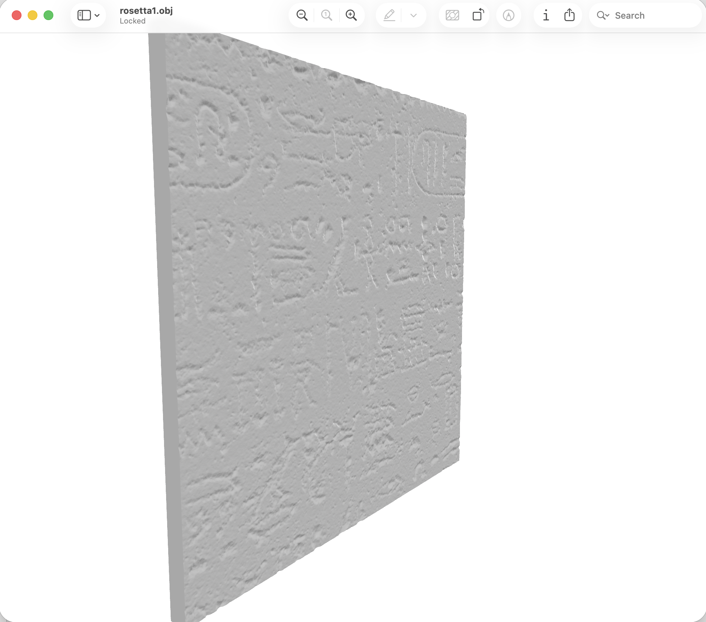

# Depthmap-to-3D-model

A Python script ([depthmap_to_obj.py](depthmap_to_obj.py)) that converts a
rectangular region of a Depthmap image into a watertight 3D mesh (`.obj`), using each
pixel's brightness as a depth (height) value. It's useful for turning
depth-map-style images — grayscale height maps, rubbings, or shaded relief
photos of inscriptions/reliefs — into a printable or viewable 3D model.



## Test it on your browser

https://digitalepigraphy.github.io/Depthmap-to-3D/

## What it does

1. Loads the source image and crops out the rectangular region you specify
   (`--x`, `--y`, `--width`, `--height`).
2. Converts every pixel in that region to RGB, then to
   [HSL](https://en.wikipedia.org/wiki/HSL_and_HSV) **lightness**
   (`(max(R,G,B) + min(R,G,B)) / 2`, normalized to 0–1). Brighter pixels are
   treated as "higher" (closer to the viewer), darker pixels as "lower".
3. Builds a **watertight solid mesh** from that height field:
   - a front surface where each pixel becomes a vertex displaced in Z by its
     lightness value,
   - a flat back plane on the same X/Y grid, positioned below the lowest
     point of the front surface by `--base-thickness`,
   - side walls stitching the front and back surfaces together along all four
     edges of the region,

   so the result is a single closed solid (no holes), suitable for 3D
   printing or CAD import.
4. Writes the mesh out as a plain-text Wavefront `.obj` file.

## Requirements

- Python 3
- [NumPy](https://numpy.org/)
- [Pillow](https://python-pillow.org/) (the `PIL` image library)

Install the dependencies with:

```bash
pip install numpy pillow
```

## Usage

```bash
python depthmap_to_obj.py --image <input.png> --output <output.obj> \
    --x <left> --y <top> --width <w> --height <h> \
    --dpm <dpm> --depth-range <range> [--base-thickness <thickness>]
```

### Arguments

| Argument | Required | Default | Description |
|---|---|---|---|
| `--image` | no | `rosetta1.png` | Path to the source image. |
| `--output` | no | `rosetta1.obj` | Path to write the output OBJ file to. |
| `--x` | **yes** | — | Left edge of the region to use, in pixels. |
| `--y` | **yes** | — | Top edge of the region to use, in pixels. |
| `--width` | **yes** | — | Width of the region to use, in pixels. |
| `--height` | **yes** | — | Height of the region to use, in pixels. |
| `--dpm` | **yes** | — | Dots per metre: the scale divisor applied to every spatial value (pixel coordinates, `--depth-range`, `--base-thickness`) to produce the final mesh coordinates. |
| `--depth-range` | **yes** | — | Z depth range (before dividing by `--dpm`) assigned to a fully white pixel; darker pixels get proportionally less. Controls how "tall" the relief is. |
| `--base-thickness` | no | `35` | Thickness of the flat slab behind the lowest point of the surface (same units as `--depth-range`, also divided by `--dpm`). Controls how thick/solid the model is overall. |

Because `--dpm` divides *all* spatial quantities (the pixel region size,
`--depth-range`, and `--base-thickness`) consistently, it acts as a single
global scale knob: a larger `--dpm` shrinks the resulting model, a smaller
`--dpm` enlarges it, while the relative proportions of width/height/depth/
thickness stay the same.

### Example

Using one of the depthmap images from the [Digital Epigraphy
Rosetta Stone](https://github.com/digitalepigraphy/RosettaStone) project as
input
https://github.com/digitalepigraphy/RosettaStone/blob/main/images/rosetta1.png
:

```bash
python depthmap_to_obj.py --image rosetta1.png --output rosetta1.obj \
    --x 3000 --y 2000 --width 1000 --height 1000 \
    --dpm 300 --depth-range 12 --base-thickness 35
```

This crops a 1000×1000 px region starting at pixel (3000, 2000), builds a
relief with a depth range of 12 and a flat base 35 units thick (both scaled
by `--dpm 300`), and writes the result to `rosetta1.obj`.

On success the script prints a summary, e.g.:

```
Wrote rosetta1.obj: 2004002 vertices, 3996000 faces
```

### Choosing a region and adjusting the model

- `--x`/`--y`/`--width`/`--height` let you crop out just the part of the
  source image you're interested in — open the image in any image viewer or
  editor to read off pixel coordinates for the area you want.
- Increase `--depth-range` for a more pronounced (taller) relief, or decrease
  it for a flatter one.
- Increase `--base-thickness` for a thicker/heavier base slab, or decrease it
  for a thinner one.
- Re-run the script with different numbers to iterate — each run is quick and
  independent.

### Viewing the result

The output `.obj` file can be opened in most 3D software, e.g.
[Blender](https://www.blender.org/), [MeshLab](https://www.meshlab.net/), or
any 3D printing slicer (it's a single watertight solid, so it's printable
as-is).
